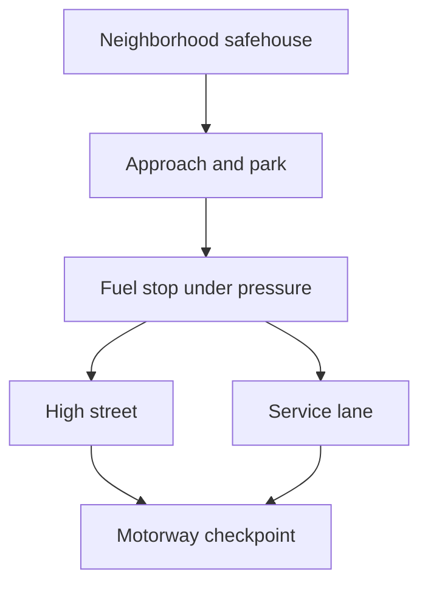

# Out of London — Vertical Slice Specification

**Status** · Proposed for pre-production review  
**Target** · One complete single-player PC mission in 10–15 minutes  
**Player** · Alex Morgan, driving a battered sedan from a neighborhood safehouse to a motorway checkpoint

## Mission contract

The player leaves with enough fuel to reach the station and must refuel to have a reliable margin for the escape. The station is the moment where the driving and on-foot loops meet. The player can watch the gauge rise while the forecourt becomes less safe, then decide when to stop fueling and which route to take. The slice ends with a running car reaching the motorway checkpoint. Its debrief explains the route taken, fuel left, vehicle condition and optional rescue outcome.

| Required for the slice | Deferred past the slice |
|---|---|
| Sedan, chase camera, one drive-to-foot-to-drive sequence, interruptible fuel transfer, readable wheel damage and recovery | Additional vehicles, garage progression, water and aircraft, companion AI, systemic city simulation |
| One safehouse, one forecourt, two escape routes, two infected archetypes, one optional rescue, two resumable checkpoints | Campaign branching, voiced cinematics, dynamic weather cycles, console certification |

## Route and pacing

| Beat | Pacing target | Player action and success cue |
|---|---:|---|
| Leave the safehouse | 1–2 min | Steer, brake and reverse before reaching traffic. Following the route sign leads to a low-fuel cue and the station approach. |
| Approach the forecourt | 2–3 min | Spot the blocked junction and a place to park. Exit from a valid door and orient toward the fuel point. |
| Refuel under pressure | 3–4 min | Start the fill, see fuel accumulate and hear the screamer's warning. Canceling preserves transferred fuel. The kiosk rescue can be attempted here. |
| Escape | 3–4 min | Re-enter the car and choose the shorter crowded high street or the longer service lane with a narrow turn and low grip. The rescue opens a shortcut off the service lane. |
| Reach the checkpoint | 1–2 min | Cross the marked motorway threshold under the car's own power. Show the route, condition, fuel and rescue result, then permit replay. |

Pacing estimates include orientation and first-time reading. Tune the overall run to the stated target before locking individual beats.

## Encounter behavior

- **Approach.** Let the player see the canopy, parking opportunity and both road exits before the danger escalates. A blocked driver-side door offers a reachable alternate entry or a clear blocked cue.
- **Pressure.** Start with walkers at a distance. The screamer telegraphs escalation with sound and a directional visual cue. If its call completes, the authored encounter budget admits reinforcements through occluded entrances. Give the player time to disengage and preserve a readable route back to the car.
- **Optional rescue.** Alex can help a worker behind the kiosk shutter. Success unlocks the service-lane shortcut and a radio report. Skipping the rescue preserves both original routes. Set the rescue flag only after the interaction resolves and keep it consistent on reload.
- **Route balance.** The high street trades short distance for crowd pressure and collision risk. The service lane trades lower enemy density for restricted steering clearance and poor grip. Both routes must be reachable and completable with the intended unmodified sedan and a partial fill established by playtests.

## Progress, failure and recovery

| State | Trigger | Recovery or persistence |
|---|---|---|
| Start checkpoint | Leave the safehouse | Restore car, fuel, damage, player and encounter state together. |
| Forecourt checkpoint | Cross the forecourt approach threshold before any fuel or rescue change | Restore approach state, preserve the same valid parking options and reset encounter progress. |
| Cancel fuel transfer | Release or cancel the fueling interaction | Return control promptly and preserve the completed amount exactly once. |
| Out of fuel | Tank reaches zero | Offer an authored recovery canister where reachable. Otherwise show a clear retry and return to the forecourt checkpoint. |
| Car unusable or player down | Engine cannot drive or the player is defeated | Show the reason, then allow retry. Retrying restores the selected checkpoint and removes temporary encounter state. |
| Mission complete | Reach motorway threshold with running engine | Lock a single completion event and summarize route, fuel, damage and rescue. |

## Minimum build list

| Owner role | Deliverable |
|---|---|
| Level design | One connected route with two exits, a safehouse apron, forecourt, kiosk, alternative door clearances and recovery points |
| Gameplay | Sedan handling, camera, foot controls, interaction ownership, fuel transfer, wheel damage, threat state, rescue flag and checkpoint logic |
| Art and audio | One hero sedan, forecourt kit, walker and screamer silhouettes, entry and exit animations, rain, headlights, audio cues and simple radio dialogue |
| UI and QA | Remappable inputs, fuel and condition feedback, directional threat cues, debrief, route and checkpoint tests |

## Definition of done

- A packaged build is completable through either base route. The rescue outcome and shortcut survive a checkpoint replay without precluding the main objective.
- At least **16 of 20** first-time participants complete the mission unaided on the agreed build. Record where they stop, why they cancel fueling, which route they choose and whether they can explain the result.
- No progression blocker remains across the save, transition, fuel and accessibility checks in the [Playtest and QA Plan](playtest-and-qa-plan.md).
- The wet-weather escape has repeatable performance captures on the agreed PC against the provisional 60 fps mode. Hardware and tuning values require approval before they become fixed targets.

Related documents · [Game design](road_v3.md) · [Technical design](technical-design.md) · [Art and audio production guide](art-and-audio-production-guide.md) · [Production roadmap](production-roadmap-and-backlog.md)
